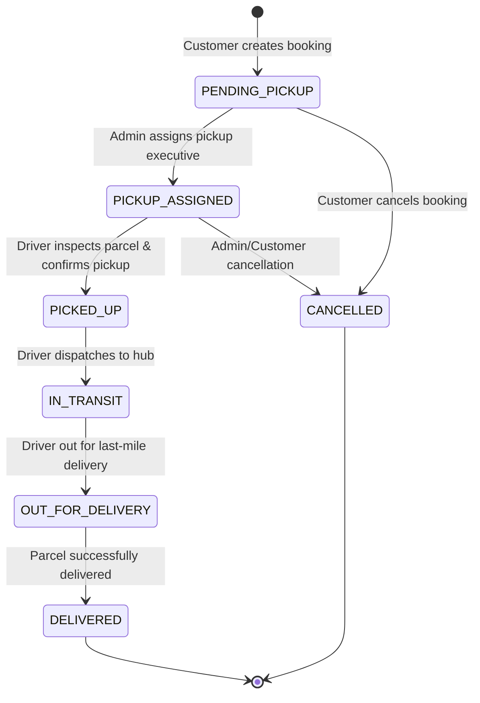

# Global Courier Platform — Backend API

FastAPI backend providing customer authentication, profile management, courier booking lifecycle, admin pickup executive assignment, parcel inspection, dynamic pricing calculation, and delivery status tracking.

---

## Quickstart & Local Setup

1. **Create and activate a virtual environment:**
   ```bash
   python -m venv .venv
   # Windows:
   .venv\Scripts\activate
   # Linux/macOS:
   source .venv/bin/activate
   ```
2. **Install dependencies:**
   ```bash
   pip install -r requirements.txt
   ```
3. **Configure Environment:**
   Copy `.env.example` to `.env` and fill in your Supabase credentials:
   ```env
   SUPABASE_URL=https://<your-project-ref>.supabase.co
   SUPABASE_ANON_KEY=<your-anon-key>
   SUPABASE_JWT_ALGORITHM=ES256
   CORS_ALLOWED_ORIGINS=["http://localhost:3000"]
   ENVIRONMENT=development
   ```
4. **Apply Database Migrations (in Supabase SQL Editor):**
   - `database/001_initial_schema.sql` (Customer profiles & auth triggers)
   - `database/002_bookings_schema.sql` (Courier bookings table, column-level security, and cancel RPC)
   - `database/003_pickup_processing_schema.sql` (Driver assignment, inspection & delivery workflow RPCs)
5. **Start Development Server:**
   ```bash
   uvicorn app.main:app --reload --port 8000
   ```
6. **Interactive Documentation:**
   - Swagger UI: `http://localhost:8000/docs`
   - ReDoc: `http://localhost:8000/redoc`

---

## API Contract & Endpoints

### 1. Authentication & Customer Profiles
| Method | Path | Auth | Status | Purpose |
|---|---|---|---|---|
| `POST` | `/api/v1/auth/register` | Public | 201 / 202 | Registers customer account with full name, phone, email, and password. |
| `POST` | `/api/v1/auth/login` | Public | 200 | Authenticates credentials and returns JWT access & refresh tokens. |
| `GET` | `/api/v1/customers/me` | Bearer | 200 | Retrieves profile of the authenticated customer. |
| `PUT` | `/api/v1/customers/me` | Bearer | 200 | Updates customer profile (name, phone, address). |

### 2. Customer Courier Bookings
| Method | Path | Auth | Status | Purpose |
|---|---|---|---|---|
| `POST` | `/api/v1/bookings` | Customer | 201 | Creates a new courier booking. Auto-generates tracking number and calculates estimated price. |
| `GET` | `/api/v1/bookings` | Customer | 200 | Lists all bookings belonging to authenticated customer (supports `?status=` filter). |
| `GET` | `/api/v1/bookings/{id}` | Customer | 200 | Retrieves booking details (RLS isolated to row owner). |
| `POST` | `/api/v1/bookings/{id}/cancel` | Customer | 200 | Cancels booking if status is `PENDING_PICKUP` using secure database RPC. |

### 3. Pricing Calculation Engine
| Method | Path | Auth | Status | Purpose |
|---|---|---|---|---|
| `POST` | `/api/v1/pricing/calculate` | Public | 200 | Real-time shipping price calculation with volumetric weight, base fee, category surcharge, packaging surcharge, and 18% GST breakdown. |

**Sample Pricing Request:**
```json
{
  "weight_kg": 2.5,
  "length_cm": 30.0,
  "width_cm": 20.0,
  "height_cm": 15.0,
  "category": "electronics",
  "packaging_status": "REPACKAGED",
  "pickup_state": "Telangana",
  "receiver_state": "Karnataka"
}
```

**Sample Pricing Response:**
```json
{
  "base_fee": 50.0,
  "chargeable_weight_kg": 2.5,
  "volumetric_weight_kg": 1.8,
  "weight_fee": 80.0,
  "category_surcharge": 100.0,
  "packaging_surcharge": 50.0,
  "interstate_fee": 80.0,
  "subtotal": 360.0,
  "tax_amount": 64.8,
  "total_price": 424.8
}
```

### 4. Admin Pickup Management
| Method | Path | Auth | Status | Purpose |
|---|---|---|---|---|
| `GET` | `/api/v1/admin/bookings` | Admin | 200 | Lists all bookings across the platform (filterable by `?status=` and `?driver_id=`). |
| `GET` | `/api/v1/admin/bookings/{id}` | Admin | 200 | Retrieves full details of any booking. |
| `POST` | `/api/v1/admin/bookings/{id}/assign` | Admin | 200 | Assigns a pickup executive to a booking. Status transitions to `PICKUP_ASSIGNED`. |

**Sample Admin Assignment Request:**
```json
{
  "driver_id": "d0ca0187-87ef-44a6-9761-546340000002"
}
```

### 5. Pickup Executive & Driver Operations
| Method | Path | Auth | Status | Purpose |
|---|---|---|---|---|
| `GET` | `/api/v1/driver/bookings` | Driver | 200 | Lists courier bookings assigned to the authenticated pickup executive. |
| `POST` | `/api/v1/driver/bookings/{id}/inspect` | Driver | 200 | Records actual weight, dimensions, packaging status. Computes `final_price` and transitions status to `PICKED_UP`. |
| `PATCH` | `/api/v1/driver/bookings/{id}/status` | Driver | 200 | Transitions delivery status along workflow (`PICKED_UP` -> `IN_TRANSIT` -> `OUT_FOR_DELIVERY` -> `DELIVERED`). |

**Sample Parcel Inspection Request:**
```json
{
  "actual_weight_kg": 2.8,
  "actual_length_cm": 35.0,
  "actual_width_cm": 25.0,
  "actual_height_cm": 15.0,
  "packaging_status": "REPACKAGED",
  "special_instructions": "Repackaged in heavy-duty cardboard with bubble wrap"
}
```

**Sample Delivery Status Transition Request:**
```json
{
  "status": "IN_TRANSIT",
  "notes": "Package dispatched from regional transit hub"
}
```

---

## Delivery Lifecycle & State Transitions



---

## Database Migrations

| Migration | File | Description |
|---|---|---|
| **001** | `database/001_initial_schema.sql` | `customer_profiles` table, auto-provisioning auth triggers, strict row-level isolation. |
| **002** | `database/002_bookings_schema.sql` | `bookings` table, column-level `UPDATE` restrictions (protecting status, driver, pricing), and `cancel_customer_booking` RPC. |
| **003** | `database/003_pickup_processing_schema.sql` | Driver assignment, parcel inspection, dynamic final pricing, driver RLS policies, and workflow transition RPCs. |

### Database Verification Scripts
- `database/test_profile_rls.sql` — Verifies customer profile cross-tenant isolation.
- `database/test_bookings_rls.sql` — Verifies column-level update security and customer cancellation RPC.
- `database/test_pickup_processing_rls.sql` — Verifies admin driver assignment, parcel inspection, and lifecycle transitions.

---

## Automated Test Suite

Run the full automated test suite from the `backend/` directory:
```bash
python -m unittest discover -s tests -v
```

**Test Coverage Summary (50 Unit & Integration Tests):**
- **Authentication & JWT (20 tests):** Sign-up, email verification handling, login, error cases, profile isolation, and multi-algorithm JWT validation (`ES256`, `RS256`, `HS256`, `AUTO`, JWKS fallback).
- **Courier Bookings & Cancellation (11 tests):** Booking creation, validation checks, status filtering, cross-customer isolation, unauthenticated rejection, and secure cancellation RPC.
- **Admin Assignment & Pickup Processing (9 tests):** Role-based authorization, driver assignment, parcel inspection, final price calculation, and delivery state transitions.
- **Pricing Calculation Engine (7 tests):** Volumetric weight formula, dead vs volumetric comparison, category surcharges, packaging surcharges, interstate fees, and GST calculation.
- **Smoke Tests (3 tests):** API health, input validation before service calls, and Bearer token enforcement.
